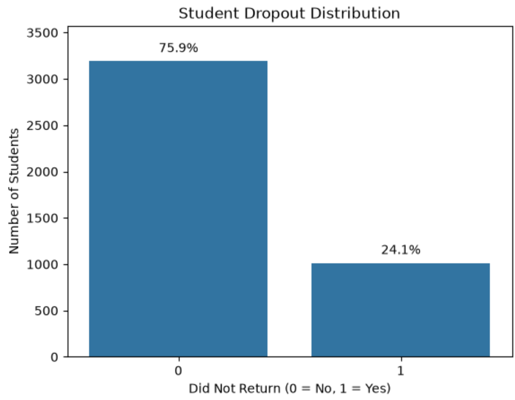
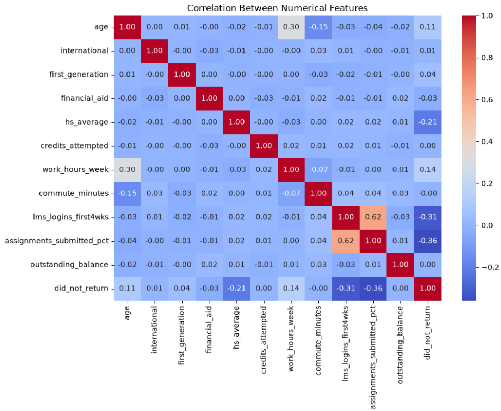
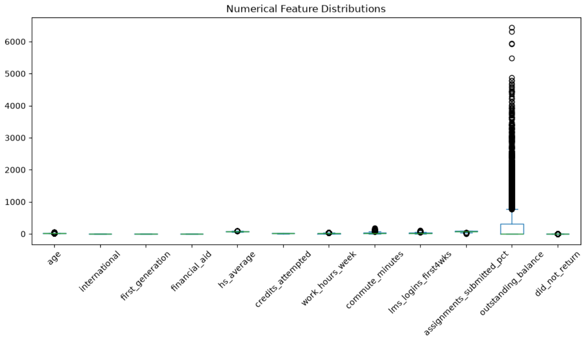
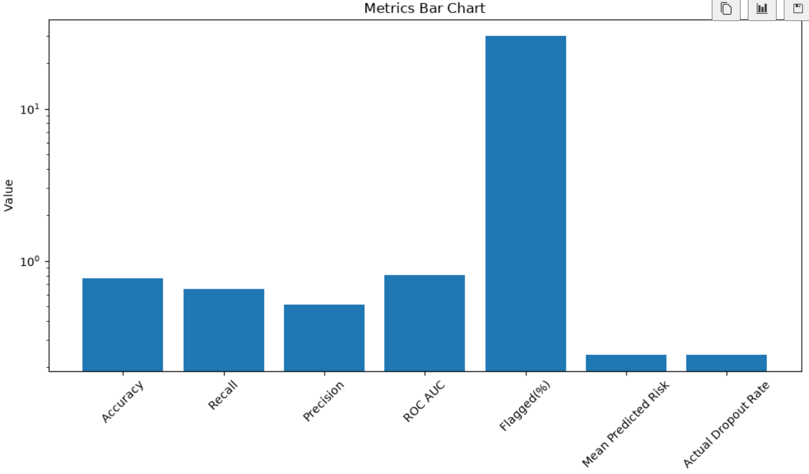
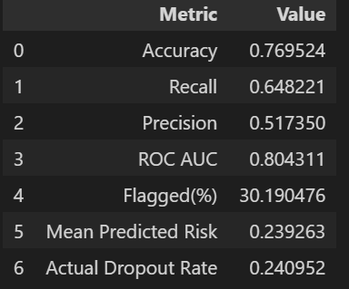
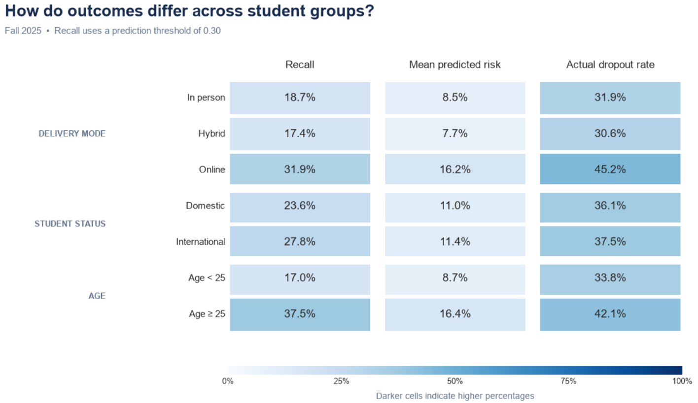
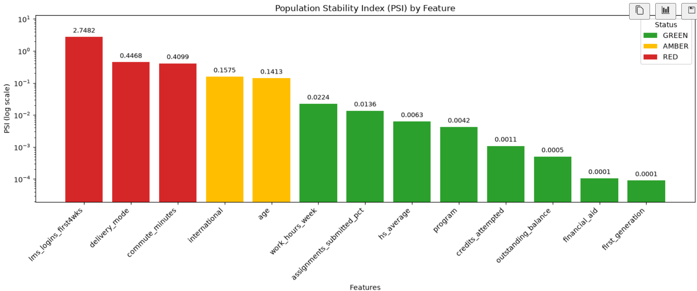
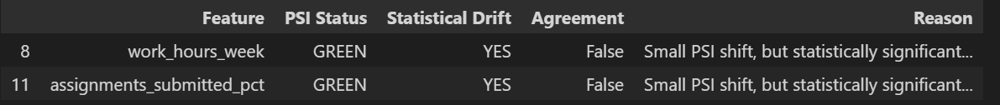

# Model-Drift-Auditor

2023 cochort data

- the class in inbalanced: 0: 3189, 1: 1011

#### Dropout Rate: 24.07%
- there is no missing value across features
- there are no duplicated student id
- there are duplicated rows
- Correlation between numerical features: there is no strong correlation between features, the only high correlation is between
  **assignments_submitted_pct** and **lms_logins_first4wks**
  

- outlier analysis

- metrics

- 

- grouped metrics

-psi 

- disagreements
